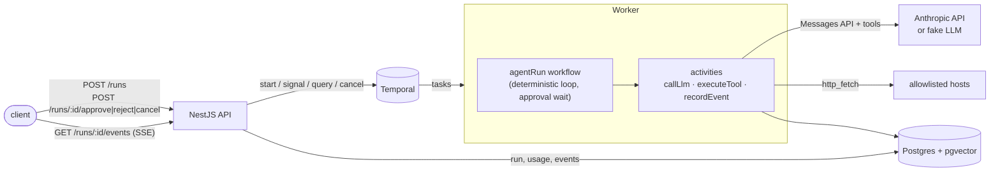

# agentflow

Durable LLM agent orchestration. Each agent run is a [Temporal](https://temporal.io) workflow that loops
**LLM call → tool calls → LLM call** until the model is done. Every step is an activity with its own timeout and retry
policy, tool calls are idempotent, risky tools wait for a human to approve them, and every token is billed to the run in
Postgres.

Stack: NestJS (TypeScript) · Temporal TypeScript SDK · PostgreSQL + pgvector (`pg`, no ORM) · Anthropic Messages API
(`@anthropic-ai/sdk`) · zod · Vitest.

## Why durable execution for agents

An agent run is a long, stateful, failure-prone process: many sequential network calls to an LLM and to tools, any of
which can rate-limit, time out or crash halfway, and some of which (writes, payments, emails) must not happen twice.
Holding that state in a request handler or a queue consumer's memory means a deploy or OOM loses the run.

With Temporal the run's progress lives in the workflow's event history. If the worker dies, another worker replays the
history, skips the steps that already finished, and retries only the one that was in flight. What that leaves to the
application is the part Temporal cannot do for you: making activities safe to run more than once, which is what the
idempotency ledger below is for.

## Architecture



Postgres tables (`src/schema.ts`):

| table | purpose |
|---|---|
| `runs` | one row per run: prompt, model, status, final output |
| `run_events` | append-only step log the SSE endpoint streams; `dedup_key` makes retried activities append once |
| `llm_calls` | tokens, cost and latency **per LLM attempt** (retries cost money too) |
| `tool_executions` | idempotency ledger keyed by `runId:toolUseId`; first recorded result wins and is replayed |
| `memories` | `vector(256)` notes for the memory tools |
| `demo.customers`, `demo.orders` | small dataset for the SQL tool |

### The workflow (`src/temporal/workflows.ts`)

1. `callLlm` (90 s timeout, 5 s heartbeat timeout, up to 5 attempts with exponential backoff). Anthropic 4xx errors other
   than 408/429 are raised as non-retryable; 429/5xx/network errors are retried by Temporal. The SDK's own retries are
   off so there is exactly one retry layer.
2. If the model asked for tools, run them one at a time:
   - tools marked `requiresApproval` (`memory_store`) set the run to `awaiting_approval` and block on
     `condition()` until an `approval` signal arrives or `approvalTimeout` (default 24 h) passes. Rejected or expired
     calls go back to the model as `is_error` tool results.
   - `executeTool` (30 s timeout, 5 s heartbeat timeout, 3 attempts). If it still fails, the model gets an error result
     and can try something else instead of the whole run failing.
3. All tool results go back in one user message; loop until the model stops calling tools or `maxSteps` is hit.
4. Cancellation (`POST /runs/:id/cancel`) interrupts whatever the workflow is waiting on; a non-cancellable scope still
   records `cancelled` in Postgres before the workflow exits.

### Tools (`src/tools`)

Schemas are zod objects (strict: unknown keys are rejected); the same schemas generate the JSON Schema sent to the model.
Bad input or policy violations come back to the model as `is_error` results; infrastructure errors throw and are retried.

| tool | what it does | guard rails |
|---|---|---|
| `http_fetch` | GET a URL, return text with tags stripped | host allowlist (exact or subdomain), `redirect: 'error'` so redirects can't leave the allowlist, 10 s timeout, 8,000-char output cap, 5xx → retry |
| `sql_query` | one SELECT/WITH against the demo data | runs inside `BEGIN READ ONLY` with a 2 s statement timeout, wrapped as a subquery (rejects multiple statements, caps 50 rows) |
| `memory_search` | cosine search over `memories` | `k` ≤ 10 |
| `memory_store` | save a note | **requires human approval**; the insert carries the idempotency key, so a retried call is a no-op |

Embeddings are a deterministic hashed bag-of-words (256 dims, `src/memory/embed.ts`): offline and free, but it matches
words, not meaning. Swapping in a real embedding model only touches `embed()`.

### LLM

`ANTHROPIC_API_KEY` set → real Anthropic Messages API with tool use (`LLM_MODEL`, default `claude-haiku-5-5`).
Unset → a deterministic scripted fake that picks one tool from keywords in the prompt and then answers from the tool
result. The fake estimates tokens as characters / 4 so cost accounting still runs; those costs are illustrative, not real
spend. Pricing per model is in `src/llm/pricing.ts` (including Haiku 5.5's long-prompt tier and cache read/write
multipliers); an unknown model fails loudly instead of being billed at $0.

## Quickstart

### With Docker

```bash
cp .env.example .env            # optionally add ANTHROPIC_API_KEY
docker compose up --build       # postgres+pgvector, temporal dev server (UI on :8233), worker, api on :3000
```

### Without Docker

Needs Node 22+. `dev:stack` runs Postgres+pgvector in-process (PGlite, in-memory, exposed over the Postgres wire
protocol on :54329) and a Temporal dev server on :7233 (the SDK downloads the binary on first use).

```bash
npm ci && npm run build
npm run dev:stack                                   # terminal 1
export DATABASE_URL='postgres://postgres@127.0.0.1:54329/postgres?sslmode=disable'
npm run start:worker                                # terminal 2 (same env)
npm run start:api                                   # terminal 3 (same env)
```

## API

```bash
# start a run
curl -s -XPOST localhost:3000/runs -H 'content-type: application/json' \
  -d '{"prompt":"What is our revenue by country?", "maxSteps": 10}'
# {"id":"d55f9a47-...","status":"queued"}

# stream its steps (Server-Sent Events; resumes from Last-Event-ID; closes after the terminal event)
curl -N localhost:3000/runs/$ID/events
# event: run_started
# id: 1
# data: {"prompt":"What is our revenue by country?","at":"..."}
#
# event: llm_response
# id: 2
# data: {"step":1,"attempt":1,"stopReason":"tool_use","usage":{"inputTokens":410,"outputTokens":69,...},"costUsd":0.0000755,...}
#
# event: tool_result
# data: {"name":"sql_query","output":"[{\"country\":\"UK\",\"revenue\":\"3100.00\"},...]","isError":false,...}
# ...
# event: run_completed

# status, output and usage (tokens + cost summed over every LLM attempt)
curl -s localhost:3000/runs/$ID
# {"id":"...","status":"completed","output":"...","usage":{"llm_calls":2,"input_tokens":958,"output_tokens":116,
#  "cache_read_tokens":0,"cache_write_tokens":0,"cost_usd":0.0001538}}
```

Human in the loop:

```bash
ID=$(curl -s -XPOST localhost:3000/runs -H 'content-type: application/json' \
  -d '{"prompt":"Remember that deploys freeze on Fridays"}' | jq -r .id)

curl -s localhost:3000/runs/$ID | jq '{status, pendingApproval}'
# {"status":"awaiting_approval","pendingApproval":{"toolUseId":"toolu_fake_1","name":"memory_store","input":{...}}}

curl -s -XPOST localhost:3000/runs/$ID/approve -H 'content-type: application/json' -d '{}'
# or: -XPOST .../reject -d '{"reason":"no secrets in memory"}'   (the model sees the reason)
# or: -XPOST .../cancel
```

Errors: invalid bodies → 400 with the zod message, unknown run → 404, approving a run that isn't waiting → 409.

## Tests

```bash
npm test          # vitest: 45 tests, no Docker, no API key, no running Postgres or Temporal needed
npm run lint
npm run typecheck
```

- `test/workflow.test.ts` — the workflow on Temporal's **time-skipping test server** with in-memory activities:
  happy path, LLM retry with backoff, non-retryable failure, tool failing past its retry budget, approve, reject,
  7-day approval timeout (skipped in milliseconds), cancellation while paused, `maxSteps`.
- `test/activities.test.ts` — activities against **PGlite** (Postgres compiled to WASM, with pgvector): cost rows per
  attempt, retryable vs non-retryable Anthropic errors, concurrent retries of `memory_store` producing one row, replayed
  results instead of re-fetching, event-log dedup across retries.
- `test/tools.test.ts` — zod validation, host allowlist, SQL guard rails (DELETE, stacked statements, data-modifying CTE,
  row cap), vector recall.
- `test/llm.test.ts` — the real Anthropic SDK path against a local mock of the Messages API, and the fake LLM.
- `test/pricing.test.ts` — cost math, cache multipliers, long-prompt tier, embeddings.

The first workflow test run downloads Temporal's test server binary (~30 s).

## Benchmark

`npm run bench` (`bench/recovery.ts`) starts a Temporal dev server, PGlite over the Postgres wire protocol, and a real
worker **process**, then measures:

- **A0** — 20 runs one after another (each: 2 fake-LLM steps + 1 `memory_search` call + event logging), create → result.
- **A** — 100 runs started at once.
- **B** — 20 runs whose tool call hits a local server that takes 5 s to answer. Once all 20 calls are in flight the
  worker gets `SIGKILL`; a fresh worker starts; the bench waits for every run and inspects Postgres.

Measured on an Apple Silicon laptop (darwin/arm64, Node 24.18, Temporal CLI 1.10.0 dev server, PGlite 0.5.16), three
consecutive runs:

| metric | run 1 | run 2 | run 3 |
|---|---|---|---|
| A0 sequential latency p50 / p95 | 300 / 303 ms | 299 / 314 ms | 300 / 304 ms |
| A concurrent latency p50 / p95 | 2555 / 4859 ms | 4179 / 5903 ms | 2353 / 4375 ms |
| A throughput | 20.2 runs/s | 14.5 runs/s | 21.7 runs/s |
| B runs completed after the crash | 20/20 | 20/20 | 20/20 |
| B SIGKILL → first / last retried tool result | 9.1 / 12.0 s | 10.1 / 12.1 s | 11.0 / 13.0 s |
| B SIGKILL → all runs completed | 19.2 s | 12.1 s | 13.1 s |
| B upstream requests (20 calls in flight at kill) | 40 | 40 | 40 |
| B recorded tool results / duplicates | 20 / 0 | 20 / 0 | 20 / 0 |

How to read it:

- Each in-flight tool call ran **twice** (40 upstream requests): activities are at-least-once, and a request sent by a
  process that died cannot be known to have completed. What the ledger guarantees is one recorded result per call
  (20 rows, 0 duplicates), and `memory_store` threads the key into its insert so the write itself happens once.
- Recovery time is bounded by the 5 s heartbeat timeout + 1 s retry backoff + the 5 s tool call running again. Without
  heartbeats the bound would be the 30 s `startToCloseTimeout`. In run 1 the last workflow resumed ~7 s after its tool
  result was recorded; the likely cause is Temporal's sticky-queue timeout for workflows cached on the dead worker, but
  that was not instrumented.
- A/A0 measure this dev setup, not a production ceiling: PGlite executes every query on a single connection, so
  concurrent runs queue behind each other.
- An earlier version of the bench reported 21 `run_completed` events for 20 runs: a `recordEvent` activity had written its
  row, the worker died before Temporal saw the completion, and the retry wrote it again. `run_events.dedup_key`
  (workflow run id + activity id [+ attempt]) fixed it; `duplicate_terminal_events` has been 0 since.

## Design decisions and trade-offs

- **Temporal owns retries.** `maxRetries: 0` on the Anthropic client; retry/backoff/timeouts live in the workflow's
  activity options, so there is one place to reason about them and they show up in Temporal's history.
- **Idempotency key = `runId:toolUseId`.** The tool-use id is part of the workflow's recorded LLM response, so it is
  stable across replays and retries. The ledger gives "record once"; side effects get "apply once" only when the key is
  carried into the side effect (as `memory_store` does). `http_fetch` is a GET and is simply re-run.
- **Tools run sequentially.** Parallel execution is easy with `Promise.all`, but one-at-a-time keeps approvals and the
  event log easy to follow. Results still go back to the model in a single message.
- **Message history lives in workflow state** and is passed to every `callLlm`. Simple and replay-safe, but history size
  grows with every step; long runs would need `continueAsNew` with a summary, or storing transcripts in Postgres and
  passing a reference.
- **SSE polls Postgres** every 300 ms per subscriber. Fine for a handful of watchers; `LISTEN/NOTIFY` would be the next
  step.
- **Read-only SQL** relies on a `READ ONLY` transaction plus a statement timeout. A production version should also use
  a dedicated database role with `SELECT` on the demo schema only; the current connection can still read other tables.
- **Plain `pg` instead of an ORM.** Six tables and a handful of queries; the `Db` interface (`src/db.ts`) is small
  enough that tests swap in PGlite with the same contract.
- **Fake LLM** is keyword-scripted, deterministic and offline. It exercises the full loop (tool use, tool results,
  usage accounting) but says nothing about model quality.

## Limitations

- Not run against the real Anthropic API in this repo's tests (no key); the SDK path is tested against a local mock of
  the Messages API.
- No auth on the API.
- Docker images were not built during development (Docker daemon unavailable); `docker compose config` validates.
- The hashed embedding has no semantic understanding.

## Layout

```
src/
  main.ts                 Nest bootstrap (API)          worker.ts      Temporal worker
  api/                    controller (REST + SSE), service
  temporal/workflows.ts   agentRun workflow, approval signal, state query
  temporal/activities.ts  callLlm, executeTool, recordEvent
  llm/                    Anthropic + fake LLM, pricing
  tools/                  zod definitions, implementations
  memory/embed.ts         hashed bag-of-words embedding
  db.ts, schema.ts        pg data layer, idempotent migration
scripts/local-stack.ts    Docker-free Postgres(PGlite)+Temporal for local dev and the bench
bench/recovery.ts         benchmark above
test/                     vitest suites
```

## License

MIT
